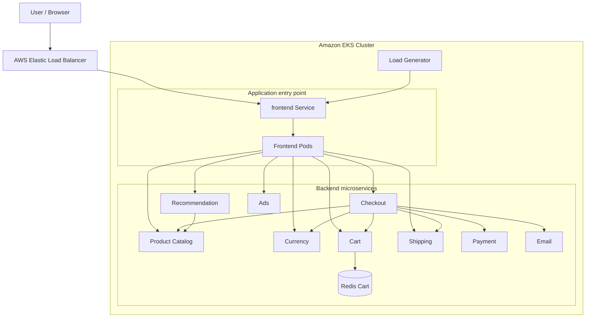
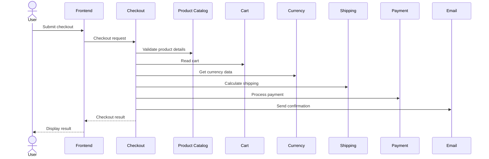
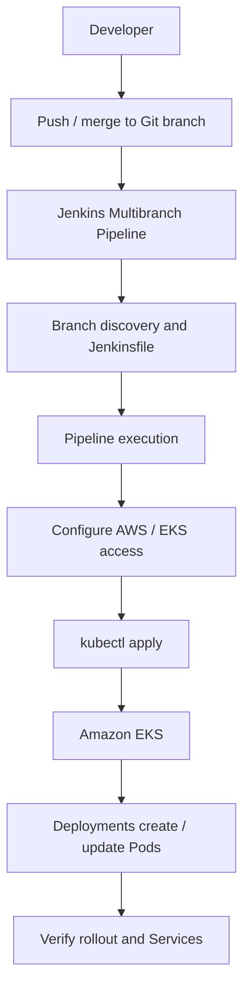
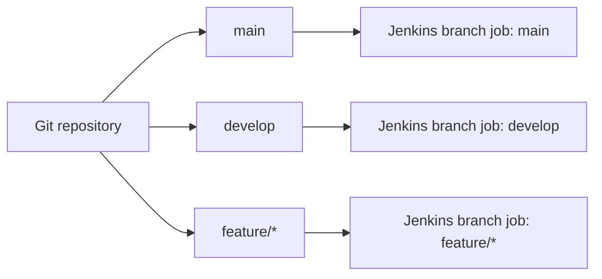

# 🛍️ Microservices Application on Amazon EKS

> **A hands-on DevOps project** demonstrating how a microservices application is deployed and verified on **Amazon Elastic Kubernetes Service (EKS)** using Kubernetes manifests and Jenkins CI/CD.

<p align="center">
  
  
  
  
</p>

---

## 📚 Table of Contents

- [Project at a glance](#-project-at-a-glance)
- [Application architecture](#-application-architecture)
- [Request and service flow](#-request-and-service-flow)
- [Repository structure](#-repository-structure)
- [Jenkins deployment flow](#-jenkins-deployment-flow)
- [Git branches and Multibranch Pipeline](#-git-branches-and-multibranch-pipeline)
- [Kubernetes resources](#-kubernetes-resources)
- [Prerequisites](#-prerequisites)
- [Deploy manually](#-deploy-manually)
- [Verify the deployment](#-verify-the-deployment)
- [Troubleshooting](#-troubleshooting)
- [Cleanup](#-cleanup)
- [Production improvement ideas](#-production-improvement-ideas)

---

## 🎯 Project at a glance

This repository contains Kubernetes deployment resources and a Jenkins pipeline for deploying a microservices application to EKS.

The application contains independently deployable services. Kubernetes `Deployment` resources manage application Pods, while Kubernetes `Service` resources provide stable network endpoints and service discovery.

### What this project demonstrates

- Deploying workloads to Amazon EKS
- Kubernetes Deployments and Services
- Namespace-based workload organization (`webapps`)
- Public application access through an AWS Load Balancer
- Internal service-to-service communication using Kubernetes DNS
- Jenkins pipeline deployment and verification
- Health probes, resource settings and selected security contexts
- Basic Kubernetes troubleshooting and operational commands

> **Scope note:** The current pipeline deploys prebuilt container images referenced by the Kubernetes manifest. It applies the manifest and verifies Services. A Docker build-and-push-to-ECR stage is not currently part of the described Jenkinsfile.

---

## 🏗️ Application architecture



### Main components

| Component | Kubernetes Service / Resource | Port | Responsibility |
|---|---|---:|---|
| Frontend | `frontend-external` | `80` | External entry point (`LoadBalancer`) |
| Frontend | `frontend` | `80` | Internal frontend endpoint |
| Product Catalog | `productcatalogservice` | `3550` | Product information and catalog lookups |
| Currency | `currencyservice` | `7000` | Currency conversion |
| Cart | `cartservice` | `7070` | Cart operations |
| Redis | `redis-cart` | `6379` | Cart data store |
| Checkout | `checkoutservice` | `5050` | Checkout workflow |
| Payment | `paymentservice` | `50051` | Payment operations |
| Shipping | `shippingservice` | `50051` | Shipping calculation |
| Email | `emailservice` | `5000` | Order confirmation |
| Recommendation | `recommendationservice` | `8080` | Product recommendations |
| Ads | `adservice` | `9555` | Advertisement data |
| Load Generator | Deployment | — | Generates application traffic |

---

## 🔄 Request and service flow

### User request flow

1. A user opens the application in a browser.
2. The request reaches the AWS Load Balancer created for the `frontend-external` Kubernetes Service.
3. The Load Balancer forwards traffic to the frontend Pods.
4. The frontend calls the required backend microservices.
5. Backend services discover each other through Kubernetes Service DNS names.
6. The Cart service uses Redis for cart data.

### Example: Checkout flow



> The sequence illustrates the service relationships documented for this project; exact application-level request ordering may depend on the implementation.

---

## 📁 Repository structure

The repository is intentionally small: the deployment configuration and pipeline are kept at the root.

```text
microservices-eks/
│
├── Jenkinsfile
│   └── Jenkins pipeline definition
│       ├── Connects to the configured EKS cluster
│       ├── Applies Kubernetes resources
│       └── Verifies deployed Services
│
├── deployment-service.yml
│   └── Kubernetes resource definitions
│       ├── Deployments
│       ├── Services
│       └── Application workload configuration
│
└── README.md
    └── Project documentation, architecture and runbook
```

### File responsibilities

| File | What it does | When you update it |
|---|---|---|
| `Jenkinsfile` | Defines the automated deployment and verification steps | When changing pipeline stages, conditions or deployment commands |
| `deployment-service.yml` | Defines Kubernetes workloads and their networking | When changing images, replicas, ports, probes or resource settings |
| `README.md` | Explains architecture, workflow, setup and operations | When project structure or deployment procedure changes |

**How to read the project:** Start with `README.md` to understand the system, inspect `Jenkinsfile` to understand automation, and then inspect `deployment-service.yml` to see what Jenkins applies to the cluster.

---

## 🚀 Jenkins deployment flow



### Current deployment steps

The current pipeline flow is:

1. Jenkins runs the pipeline defined in the repository's `Jenkinsfile`.
2. The Jenkins agent uses its configured EKS access and credentials.
3. Jenkins applies `deployment-service.yml` to the `webapps` namespace.
4. Kubernetes creates or updates the declared resources.
5. Jenkins checks the Services in the namespace.

The key deployment command is:

```bash
kubectl apply -f deployment-service.yml -n webapps
```

The current verification command documented in the project is:

```bash
kubectl get svc -n webapps
```

---

## 🌿 Git branches and Multibranch Pipeline

A **Jenkins Multibranch Pipeline** is useful when the repository contains several branches. Jenkins scans the repository and creates a pipeline job for each discovered branch that contains a `Jenkinsfile`.



### Important distinction

- **Multibranch Pipeline** = Jenkins discovers and manages pipelines for multiple Git branches.
- **Pipeline stages** = steps inside one pipeline, such as Checkout, Test, Deploy and Verify.

Branch-based deployment rules (for example, deploying `develop` to a development namespace and `main` to production) must be explicitly configured in the `Jenkinsfile` and environment setup. They do not happen automatically just because a Multibranch Pipeline job exists.

---

## ☸️ Kubernetes resources

The manifest contains the Kubernetes resources required by the application.

| Resource | Purpose |
|---|---|
| `Deployment` | Maintains application Pods and supports rolling updates |
| `Service` | Provides a stable endpoint for Pods |
| `LoadBalancer` Service | Requests an external AWS load balancer for the frontend |
| `Namespace` | Separates the application resources under `webapps` |

The project also documents configuration such as probes, CPU/memory requests and limits, and selected container security settings.

---

## ✅ Prerequisites

Before deployment, ensure that:

- An Amazon EKS cluster is available.
- Jenkins and its agent can reach the EKS API endpoint.
- `kubectl` is installed on the Jenkins agent.
- Jenkins has the required AWS/EKS authentication and Kubernetes permissions.
- The `webapps` namespace exists.
- Container images referenced in the manifest are accessible to the cluster.
- AWS permissions required for the LoadBalancer Service are configured.

Create the namespace if it does not already exist:

```bash
kubectl create namespace webapps
```

---

## 🧑‍💻 Deploy manually

Use this procedure to validate cluster access and the manifest independently of Jenkins.

```bash
# Confirm the active Kubernetes context
kubectl config current-context

# Check cluster access
kubectl get nodes

# Create the namespace if needed
kubectl create namespace webapps

# Apply the application resources
kubectl apply -f deployment-service.yml -n webapps
```

---

## 🔍 Verify the deployment

```bash
# View resources in the application namespace
kubectl get all -n webapps

# Check Pods
kubectl get pods -n webapps

# Check Deployments
kubectl get deployments -n webapps

# Check Services
kubectl get svc -n webapps

# Inspect the external frontend Service
kubectl describe svc frontend-external -n webapps
```

Wait for the frontend Service's external address to be provisioned by AWS. The external address is shown in the `EXTERNAL-IP` column (it may display an AWS load-balancer DNS name).

---

## 🛠️ Troubleshooting quick reference

| Symptom | First checks |
|---|---|
| Pod is `Pending` | `kubectl describe pod <pod> -n webapps`; check scheduling and resource constraints |
| Pod is `CrashLoopBackOff` | `kubectl logs <pod> -n webapps` and `kubectl logs <pod> -n webapps --previous` |
| Pod is `ImagePullBackOff` | Check image name/tag and registry access |
| Service has no endpoints | Check Pod labels, selectors and readiness |
| External address is pending | `kubectl describe svc frontend-external -n webapps`; check AWS Load Balancer provisioning and permissions |
| Jenkins cannot deploy | Check agent network access, EKS authentication, RBAC and namespace |

Useful commands:

```bash
kubectl describe pod <pod-name> -n webapps
kubectl logs <pod-name> -n webapps
kubectl logs <pod-name> -n webapps --previous
kubectl get endpoints -n webapps
kubectl auth can-i get pods -n webapps
```

---

## 🧹 Cleanup

Delete the application resources:

```bash
kubectl delete -f deployment-service.yml -n webapps
```

To remove the namespace and its remaining resources:

```bash
kubectl delete namespace webapps
```

> Deleting a namespace removes the resources inside it. Confirm that you are targeting the intended cluster and namespace before running cleanup.

---

## 📈 Production improvement ideas

The current repository is a useful learning and deployment baseline. Potential next steps include:

- Use immutable image tags instead of `latest`.
- Build and push application images to Amazon ECR in CI.
- Add automated tests and image vulnerability scanning.
- Use Helm or Kustomize for environment-specific configuration.
- Configure replicas, autoscaling and Pod Disruption Budgets.
- Use an Ingress and AWS Load Balancer Controller where appropriate.
- Configure TLS, least-privilege access and Kubernetes NetworkPolicies.
- Replace ephemeral Redis storage with a durable or managed Redis solution.
- Add centralized logs, metrics, dashboards and alerts.

---

## 💡 Interview explanation

> “This project is a microservices application running on Amazon EKS. The Kubernetes manifest defines the application Deployments and Services. The frontend is exposed externally through a LoadBalancer Service, while backend services communicate internally through Kubernetes Service discovery. Jenkins automates deployment by connecting to the EKS cluster, applying the manifest in the `webapps` namespace, and verifying the Services. The repository can be managed through a Jenkins Multibranch Pipeline when multiple Git branches need separate pipeline jobs.”

---

<p align="center">
  <b>Built to learn • Deploy • Troubleshoot • Explain</b>
</p>
