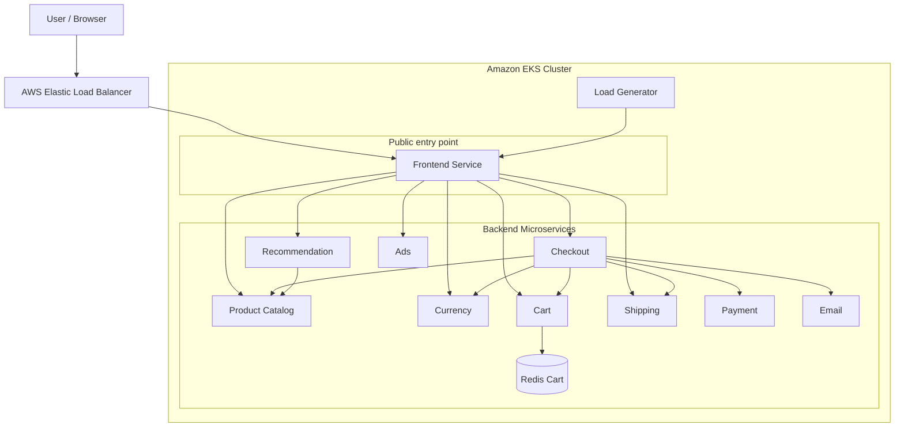
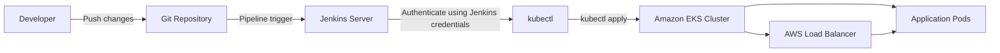

# Microservices Application on Amazon EKS

## Project Overview

This project demonstrates the deployment of a cloud-native microservices application on **Amazon Elastic Kubernetes Service (EKS)** using Kubernetes manifests and Jenkins CI/CD automation.

The application uses multiple independently deployable services. Public traffic enters through an AWS Elastic Load Balancer and is routed to the frontend service. Internal microservices communicate with each other through Kubernetes DNS and gRPC or Redis connections. Kubernetes Services provide stable service discovery, and Deployments manage pod availability and scaling.

The repository represents an infrastructure and platform engineering implementation suitable for a DevOps engineer with 4+ years of experience, covering:

- Amazon EKS workload deployment
- Kubernetes Deployments, Services, probes, resources, and security contexts
- AWS LoadBalancer exposure
- Jenkins-based deployment automation
- Kubernetes namespace isolation
- Container image management
- Health monitoring and service discovery
- Microservices dependency mapping

## Application Architecture



### Architecture Components

| Component | Kubernetes Service | Port | Purpose |
|---|---|---:|---|
| Frontend | `frontend-external` | `80` (LoadBalancer) | Public web entry point |
| Frontend | `frontend` | `80` | Internal service endpoint |
| Product Catalog | `productcatalogservice` | `3550` | Product data and catalog lookups |
| Currency | `currencyservice` | `7000` | Currency conversion |
| Cart | `cartservice` | `7070` | Shopping cart operations |
| Redis | `redis-cart` | `6379` | Cart data storage |
| Checkout | `checkoutservice` | `5050` | Coordinates checkout workflow |
| Payment | `paymentservice` | `50051` | Payment processing |
| Shipping | `shippingservice` | `50051` | Shipping calculation |
| Email | `emailservice` | `5000` | Order confirmation service |
| Recommendation | `recommendationservice` | `8080` | Product recommendations |
| Ads | `adservice` | `9555` | Advertisement data |
| Load Generator | Deployment only | - | Generates continuous application traffic |

## Repository Structure

```text
.
|-- Jenkinsfile              # Jenkins pipeline for deployment and verification
|-- deployment-service.yml   # EKS Deployments and Kubernetes Services
`-- README.md                # Project documentation
```

## Deployment Architecture



The Jenkins pipeline:

1. Connects to the configured EKS cluster.
2. Uses the Kubernetes credentials stored in Jenkins.
3. Deploys all resources from `deployment-service.yml`.
4. Targets the `webapps` namespace.
5. Runs `kubectl get svc -n webapps` to verify the Services.

## Prerequisites

| Requirement | Purpose |
|---|---|
| Amazon EKS cluster | Runs all Kubernetes workloads |
| Jenkins server or Jenkins agent | Runs the pipeline |
| `kubectl` on the Jenkins agent | Applies and verifies Kubernetes manifests |
| Jenkins Kubernetes credential | Authenticates the pipeline to the EKS API server |
| EKS ServiceAccount and RBAC | Authorizes Kubernetes operations performed by Jenkins |
| Docker or container runtime | Required only when the pipeline builds or pushes images |
| Docker Hub or Amazon ECR credentials | Required only for private image registries |
| AWS Load Balancer permissions | Allows EKS to provision the external AWS Load Balancer |

Create the application namespace before the first deployment:

```bash
kubectl create namespace webapps
```

## Jenkins Multibranch and Pipeline Setup

The repository uses a declarative `Jenkinsfile` with these stages:

1. **Deploy To Kubernetes** - Runs `kubectl apply -f deployment-service.yml`.
2. **verify Deployment** - Runs `kubectl get svc -n webapps`.

The pipeline currently deploys prebuilt container images referenced in `deployment-service.yml`. It does **not** contain a Docker build or Docker push stage.

### Create a Jenkins Pipeline Job

1. Open **Jenkins > New Item**.
2. Enter a job name such as `microservices-eCommerce`.
3. Select **Pipeline**.
4. Under **Pipeline**, select **Pipeline script from SCM**.
5. Select **Git** as the SCM.
6. Enter the repository URL.
7. Select a branch or configure the Jenkins branch strategy.
8. Set **Script Path** to `Jenkinsfile`.
9. Save the job and select **Build Now**.

For a repository with multiple application branches, use **Multibranch Pipeline** instead:

1. Select **New Item > Multibranch Pipeline**.
2. Add the Git repository in **Branch Sources**.
3. Set the Jenkinsfile path to `Jenkinsfile`.
4. Configure webhook or scheduled branch discovery.
5. Jenkins creates a pipeline for each discovered branch containing a Jenkinsfile.

The Jenkins agent must have network access to the EKS API endpoint and must contain:

```bash
kubectl version --client
kubectl get namespace webapps
```

Install the Jenkins Kubernetes CLI or Kubernetes Credentials plugin if `withKubeCredentials(...)` is not recognized.

## Docker Credentials in Jenkins

Docker credentials are only required when Jenkins must build, log in to, or pull/push private container images.

The current manifest already references public Docker Hub images such as `shaikmustafa77/frontend:latest`. Therefore, Jenkins does not require Docker credentials for this repository as-is.

For private images or Amazon ECR:

1. Open **Jenkins > Manage Jenkins > Credentials**.
2. Select the Jenkins scope and domain.
3. Choose **Add Credentials**.
4. Select **Username with password**.
5. Enter:
   - Docker Hub/ECR username
   - Docker Hub token or ECR password
   - A credential ID, for example `docker-hub-creds` or `ecr-creds`

Example Jenkins stage for Docker authentication:

```groovy
stage('Build And Push Image') {
    steps {
        withCredentials([usernamePassword(
            credentialsId: 'docker-hub-creds',
            usernameVariable: 'DOCKER_USER',
            passwordVariable: 'DOCKER_PASS'
        )]) {
            sh '''
                echo "$DOCKER_PASS" | docker login -u "$DOCKER_USER" --password-stdin
                docker build -t myregistry/frontend:${BUILD_NUMBER} .
                docker push myregistry/frontend:${BUILD_NUMBER}
            '''
        }
    }
}
```

Use `docker logout` after the push stage or a credential isolation pattern in Jenkins agent containers. Never place registry passwords directly in `Jenkinsfile`.

If Amazon ECR is used, an IAM principal/role attached to the Jenkins instance or agent must have ECR permissions. Authenticate with the AWS CLI before pushing:

```bash
aws ecr get-login-password --region ap-south-1 |
  docker login --username AWS --password-stdin <account-id>.dkr.ecr.ap-south-1.amazonaws.com
```

## Jenkins to EKS Credentials

The `credentialsId: 'k8-token'` value in `Jenkinsfile` must match a credential ID in Jenkins. This credential identifies the identity Jenkins uses to call the EKS Kubernetes API.

It is separate from Docker credentials.

### Option A: Kubernetes bearer token credential

This option is suitable when a Jenkins deployment ServiceAccount is created in EKS and a token is stored in Jenkins.

Create a namespace and deployment service account:

```bash
kubectl create namespace webapps
kubectl create serviceaccount jenkins-deployer -n webapps
```

Create `jenkins-deployer-rbac.yaml`:

```yaml
apiVersion: rbac.authorization.k8s.io/v1
kind: Role
metadata:
  name: jenkins-deployer
  namespace: webapps
rules:
  - apiGroups: ["", "apps"]
    resources: ["deployments", "replicasets", "services", "pods"]
    verbs: ["get", "list", "watch", "create", "update", "patch", "delete"]
---
apiVersion: rbac.authorization.k8s.io/v1
kind: RoleBinding
metadata:
  name: jenkins-deployer
  namespace: webapps
subjects:
  - kind: ServiceAccount
    name: jenkins-deployer
    namespace: webapps
roleRef:
  kind: Role
  apiGroup: rbac.authorization.k8s.io
  name: jenkins-deployer
```

Apply the role and role binding:

```bash
kubectl apply -f jenkins-deployer-rbac.yaml
```

Create a token for the ServiceAccount on Kubernetes versions that support token requests:

```bash
kubectl create token jenkins-deployer -n webapps
```

Do not use an unlinked, manually generated Secret as a Kubernetes credential. For Kubernetes versions that support bound ServiceAccount tokens, `kubectl create token jenkins-deployer -n webapps` is the preferred short-lived token method. For Jenkins agents running in the cluster or on AWS, consider EKS Pod Identity or IAM Roles for Service Accounts instead of copying tokens.

In Jenkins:

1. Open **Manage Jenkins > Credentials**.
2. Add a credential accepted by the Kubernetes CLI credentials plugin.
3. Set the ID exactly to `k8-token`.
4. Store the bearer token or kubeconfig securely.

The Jenkins credential must be usable with this pipeline block:

```groovy
withKubeCredentials(kubectlCredentials: [[
    caCertificate: '',
    clusterName: 'EKS-1',
    contextName: '',
    credentialsId: 'k8-token',
    namespace: 'webapps',
    serverUrl: 'https://<eks-api-server-endpoint>'
]]) {
    sh 'kubectl apply -f deployment-service.yml'
}
```

Replace `<eks-api-server-endpoint>` with:

```bash
aws eks describe-cluster \
  --name <cluster-name> \
  --region <aws-region> \
  --query 'cluster.endpoint' \
  --output text
```

### Option B: AWS IAM authentication

If Jenkins uses IAM authentication instead of a bearer token, configure `aws-auth` or EKS access entries to map the Jenkins IAM role to a Kubernetes identity. Grant that identity a Role and RoleBinding in `webapps`.

The Jenkins agent must have AWS credentials and `aws-cli`/`kubectl`:

```bash
aws eks update-kubeconfig \
  --region <aws-region> \
  --name <cluster-name>

kubectl auth can-i get pods -n webapps
kubectl auth can-i create deployments -n webapps
kubectl auth can-i create services -n webapps
```

Use IAM Roles for Service Accounts or EC2 instance roles for Jenkins agents rather than long-lived AWS access keys. Do not store AWS access keys in `Jenkinsfile`.

## Current Jenkinsfile Behavior

The existing pipeline:

```groovy
pipeline {
    agent any

    stages {
        stage('Deploy To Kubernetes') {
            steps {
                withKubeCredentials(/* EKS server and k8-token credential */) {
                    sh 'kubectl apply -f deployment-service.yml'
                }
            }
        }

        stage('verify Deployment') {
            steps {
                withKubeCredentials(/* same EKS server and credential */) {
                    sh 'kubectl get svc -n webapps'
                }
            }
        }
    }
}
```

Before running it:

1. Create `webapps` in EKS.
2. Create the Jenkins Kubernetes credential with ID `k8-token`.
3. Create the EKS ServiceAccount and namespace-scoped Role/RoleBinding.
4. Replace the EKS `serverUrl` with your cluster endpoint.
5. Replace `clusterName: 'EKS-1'` with the cluster name used in Jenkins.
6. Ensure the Jenkins agent can reach and authenticate to EKS.
7. Run `kubectl apply -f deployment-service.yml -n webapps` once manually to verify credentials and RBAC.

### Option 2: Deploy manually

```bash
kubectl apply -f deployment-service.yml -n webapps
kubectl get deployments -n webapps
kubectl get pods -n webapps
kubectl get services -n webapps
```

### Verify the frontend Load Balancer

```bash
kubectl get service frontend-external -n webapps
kubectl describe service frontend-external -n webapps
```

Wait until `EXTERNAL-IP` contains an AWS Load Balancer DNS name, then open:

```text
http://<EXTERNAL-IP>
```

## Kubernetes Resource Details

- The frontend and microservices use Kubernetes `ClusterIP` Services for internal communication.
- The `frontend-external` Service uses `type: LoadBalancer`.
- Kubernetes DNS names such as `cartservice:7070` are used for service-to-service discovery.
- Deployments define liveness and readiness probes for most services.
- CPU and memory requests and limits are configured for predictable scheduling.
- Redis uses `emptyDir` storage and is therefore not durable across pod replacement.
- `runAsNonRoot`, dropped Linux capabilities, and disabled privilege escalation are configured for the email service pod.
- The load generator continuously sends traffic to the frontend.

## Production and Operations Recommendations

The current manifests are a good functional EKS baseline, but the following improvements are recommended before production use:

### Container Registry

- Replace public mutable `latest` image tags with immutable version tags or commit SHAs.
- Push application images to private Amazon ECR repositories.
- Add container vulnerability scanning and image signing.

### Availability

- Set explicit replica counts for stateless services.
- Add Pod Disruption Budgets.
- Configure Horizontal Pod Autoscalers.
- Distribute replicas across multiple availability zones using topology spread constraints.
- Use a cluster autoscaler or Karpenter for node scaling.

### Networking and Security

- Add an AWS Load Balancer Controller and use an Ingress instead of a LoadBalancer Service per application.
- Enable TLS using ACM and HTTPS.
- Configure Kubernetes NetworkPolicies.
- Add AWS IAM Roles for Service Accounts.
- Do not grant broad cluster permissions to the Jenkins deployment credential.
- Rotate the Jenkins and Kubernetes credentials regularly.

### Data

- Replace the Redis `emptyDir` volume with a durable managed or cluster-backed Redis deployment.
- Consider Amazon ElastiCache for Redis if Redis availability is managed by AWS.
- Add backup and recovery procedures for stateful data.

### CI/CD

- Build and publish images before deployment.
- Add manifest validation, security scanning, and smoke tests.
- Promote immutable image digests between environments.
- Replace direct credential-based Jenkins access with short-lived AWS or Kubernetes authentication.
- Implement separate development, staging, and production environments.
- Use Helm or Kustomize for environment-specific configuration.

### Observability

- Send application and Kubernetes logs to Amazon CloudWatch or an equivalent log platform.
- Add metrics and dashboards using Prometheus and Grafana or Amazon Managed Service for Prometheus.
- Add distributed tracing using AWS Distro for OpenTelemetry.
- Create alerts for pod restarts, readiness failures, resource saturation, and 5xx errors.

## Troubleshooting

Check all resources:

```bash
kubectl get all -n webapps
```

Check pod status:

```bash
kubectl get pods -n webapps
kubectl describe pod <pod-name> -n webapps
```

View pod logs:

```bash
kubectl logs <pod-name> -n webapps
kubectl logs <pod-name> -n webapps --previous
```

Verify a Service:

```bash
kubectl get service <service-name> -n webapps
kubectl describe service <service-name> -n webapps
kubectl get endpoints <service-name> -n webapps
```

Check frontend connectivity:

```bash
kubectl run curl-test --rm -it --restart=Never --image=curlimages/curl -- \
  curl -I http://frontend-external.webapps.svc.cluster.local
```

## Cleanup

```bash
kubectl delete -f deployment-service.yml -n webapps
```

To remove the namespace:

```bash
kubectl delete namespace webapps
```
